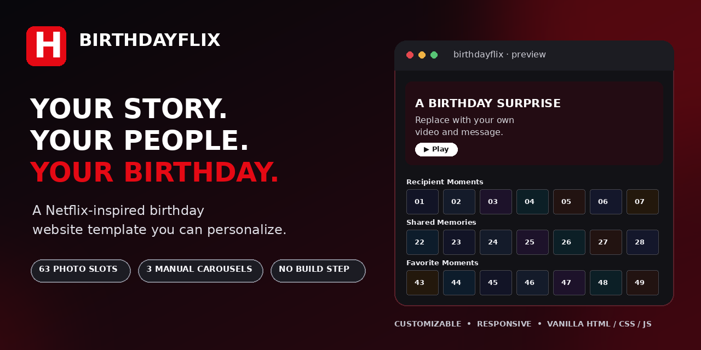
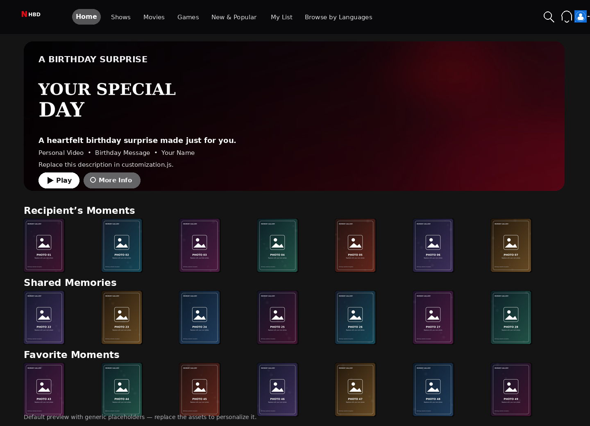

<div align="center">

# 🎬 BirthdayFlix

### A customizable, Netflix-inspired birthday website template

Create a personal birthday experience with a cinematic hero, three photo carousels, hover previews, profile selection, a demo PIN screen, and a heartfelt message.

[](https://developer.mozilla.org/docs/Web/HTML)
[](https://developer.mozilla.org/docs/Web/CSS)
[](https://developer.mozilla.org/docs/Web/JavaScript)
[](#run-locally)
[](#features)

**Bring your own photos, video, names, and message.** No framework or build tool required.

</div>



### Default website preview

This preview uses generic placeholder media. Replace the assets to personalize it.



> **Independent fan-made template.** This project is not affiliated with, endorsed by, or sponsored by Netflix, Inc. Netflix names, logos, UI elements, and other marks belong to their respective owners. Replace brand-specific assets and links as appropriate before public or commercial use.

## ✨ Features

- 🎞️ Cinematic hero section with background video, overlay, and Play / More Info actions
- 🖼️ **Three independent manual carousels** with 21 replaceable portrait placeholders each (63 image slots total)
- 🪄 Netflix-inspired hover preview cards that sit above the carousel without changing thumbnail size
- 👤 Two demo profiles, a profile switcher, and a front-end PIN flow
- 💌 More Info modal for a personal birthday message and image
- 📱 Responsive desktop and mobile layout
- ♿ Keyboard-friendly controls and accessible labels where practical
- ⚙️ One central `customization.js` file for names, text, demo accounts, gallery titles, and PIN
- 🧰 Plain HTML, CSS, and JavaScript — no build step or package installation

## 🚀 Quick start

1. Download or clone this repository.
2. Open `customization.js` and change the names, titles, message, demo accounts, and demo PIN.
3. Replace the files in `images/` and `video/video.mp4` with your own media, keeping the filenames the same.
4. Start a local web server from the project root:

   ```bash
   python -m http.server 8000
   ```

5. Open [http://localhost:8000/loginPage.html](http://localhost:8000/loginPage.html).

A local server is recommended because browser storage, media playback, and relative asset paths can behave differently when opening files directly with `file://`.

## 🛠️ Customize it

Start with [`customization.js`](customization.js). This file controls:

| Setting | What it changes |
|---|---|
| `recipientName` | Birthday recipient's name across the pages |
| `senderName` | Sender name and message sign-off |
| `creatorName` / `year` | Footer credit |
| `messageTitle` | Heading in the More Info modal |
| `galleryTitles` | Names of all three carousel rows |
| `customTagline` | Short description shown in hover previews |
| `heroDescription` | Text beside the featured hero video |
| `birthdayMessage` / `closingMessage` | Personal message and closing line |
| `demoAccounts` | Sample email/password pairs for the demo sign-in |
| `demoPin` | Four-digit demo PIN |

Detailed instructions: [`docs/CUSTOMIZATION.md`](docs/CUSTOMIZATION.md).

### Replaceable media

| File or pattern | Purpose |
|---|---|
| `images/logo.png` | Small header / profile-page wordmark |
| `images/recipient-profile.png` | Recipient profile avatar |
| `images/sender-profile.png` | Sender profile avatar |
| `images/hero-title.png` | Title artwork over the hero video |
| `images/featured-cover.jpg` | Hero poster and More Info cover |
| `images/message-artwork.png` | Image at the end of the birthday message |
| `images/1.jpg` – `images/63.jpg` | Three galleries, 21 images per row |
| `video/video.mp4` | Hero background and playable video |
| `audio/celebration-chime.mp3` | Original generic confirmation chime |

The included images and video are **generic placeholders**, not personal media. You can overwrite them with your own files using the same names. Gallery cards keep a 3:4 portrait display ratio with `object-fit: cover`; source images do not need to be cropped to that ratio first.

## 🔐 Demo sign-in and security

Default demo credentials are listed in `customization.js`:

| Profile | Email | Password |
|---|---|---|
| Recipient | `recipient@example.com` | `demo1234` |
| Sender | `sender@example.com` | `demo5678` |

The default demo PIN is `1234`.

**This is a front-end demo, not real authentication.** Credentials and the PIN live in client-side JavaScript and can be inspected or bypassed. Do not use real passwords, private information, or this flow to protect confidential photos. Treat the website as public once it is published, and only upload media you have permission to share.

## 📁 Project structure

```text
.
├── index.html
├── loginPage.html
├── profiles.html
├── pin.html
├── customization.js       # Edit names, copy, demo accounts, and PIN here
├── script.js
├── profiles.js
├── pin.js
├── landing.css
├── responsive.css
├── style.css
├── profiles.css
├── pin.css
├── favicon.ico
├── images/                # Replace the generic placeholders
├── video/video.mp4        # Replace with your own clip
├── audio/                 # Generic chime
├── docs/                  # Customization, research, publishing guide, preview
└── .github/               # Issue and pull-request templates
```

## 🧪 Test checklist

Before sharing your personalized version, check:

- [ ] The login demo accepts the credentials shown in `customization.js`.
- [ ] Both profiles can be selected and the demo PIN works.
- [ ] All three carousels move only when a user clicks an arrow or swipes.
- [ ] Hover previews appear fully and do not resize the underlying thumbnails.
- [ ] The hero video, Play modal, More Info modal, and close buttons work.
- [ ] All 63 gallery files and the profile / cover assets load.
- [ ] The layout works on desktop and mobile.
- [ ] You removed any sample text, demo credentials, or assets you do not want to publish.

## 🌐 Publishing

You can host this static site on any suitable static web host. See [`docs/GITHUB_PUBLISHING.md`](docs/GITHUB_PUBLISHING.md) for GitHub Topics, the repository-template setting, a social preview, and a release checklist. The included `vercel.json` is optional and only provides a root redirect for Vercel deployments.

## 🔎 Research and design references

This template was informed by common patterns in public Netflix-inspired UI and birthday-website projects. See [`docs/REFERENCE_REVIEW.md`](docs/REFERENCE_REVIEW.md) for a short comparison. The code in this repository was adapted for this template rather than copied wholesale from those projects.

## ⚖️ License and third-party assets

No license is included yet. A public GitHub repository is not automatically permission for others to reuse, modify, or redistribute the code; choose and add a license before describing the project as open source. The project also loads Bootstrap, Bootstrap Icons, a font stylesheet, and the favicon endpoint from external services. Review their terms and replace any brand-specific links or artwork before redistribution or commercial use.

## 🤝 Contributing

Ideas, bug reports, and improvements are welcome. Read [`CONTRIBUTING.md`](CONTRIBUTING.md) before opening an issue or pull request.

---

<div align="center">
Made for personal birthday surprises. Customize it, make it yours, and share it thoughtfully. ❤️
</div>
